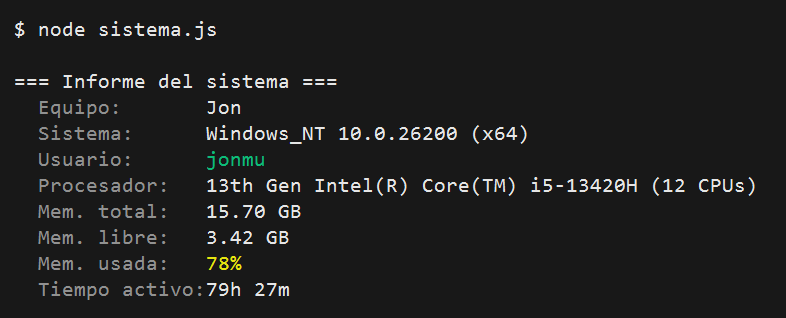
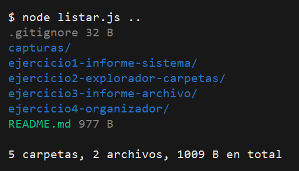
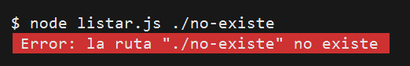
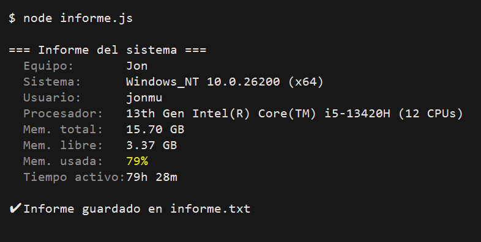
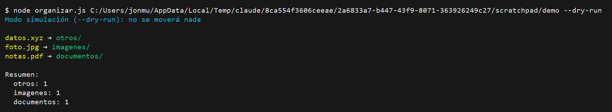

# ejercicios-introduccion-nodejs

**Integrante:** jonmu (grupo: _indicar_)

Asignatura: Programación de Servicios y Procesos · Bloque 00 · Fundamentos de Node.js (CommonJS + picocolors).

## Ejercicios

| Carpeta | Descripción | Ejecutar |
|---|---|---|
| `ejercicio1-informe-sistema` | Informe del sistema (`os`) con colores; la RAM usada cambia de color según el porcentaje. | `node sistema.js` |
| `ejercicio2-explorador-carpetas` | Lista el contenido de una ruta (`fs`, `path`) con resumen final. | `node listar.js [ruta]` |
| `ejercicio3-informe-archivo` | Como el 1, y guarda `informe.txt` (sobrescribe) y `historial.log` (añade línea). | `node informe.js` |
| `ejercicio4-organizador` (extra) | Clasifica archivos por extensión; admite `--dry-run`. | `node organizar.js <carpeta> [--dry-run]` |

## Instalación

En cada carpeta:

```bash
npm install
node <archivo>.js
```

## Capturas

### Ejercicio 1


### Ejercicio 2


Error con ruta inexistente:



### Ejercicio 3


### Ejercicio 4 (extra, `--dry-run`)

